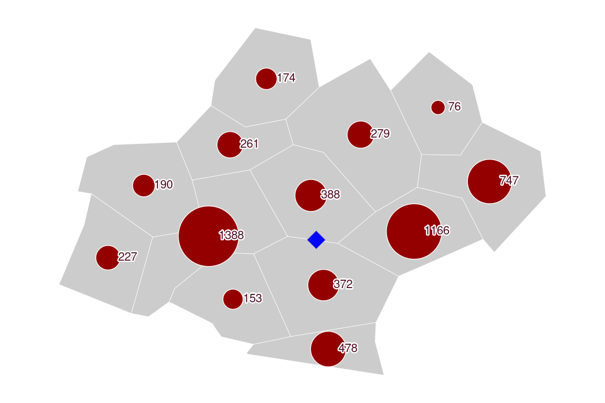
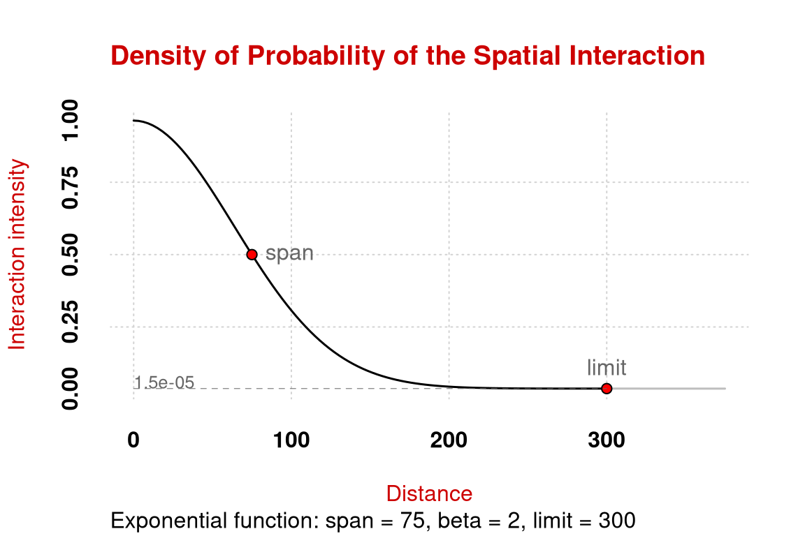
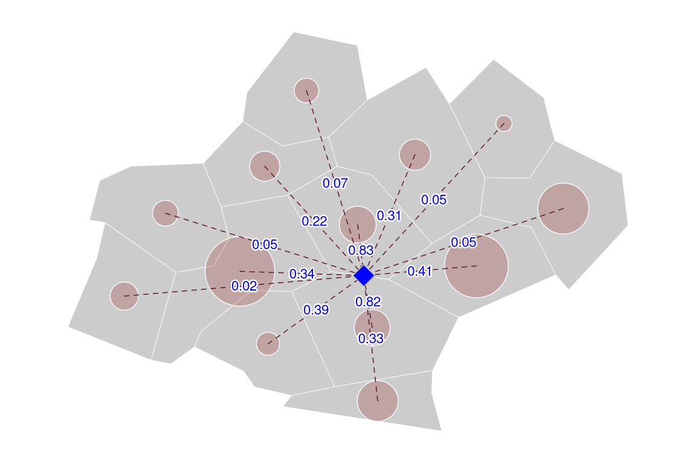
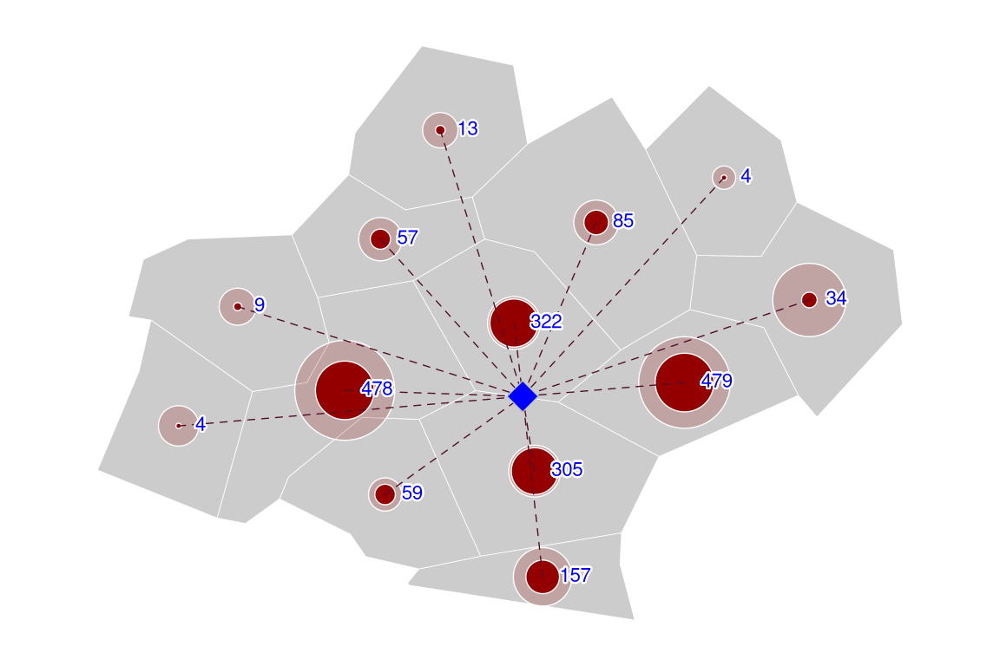
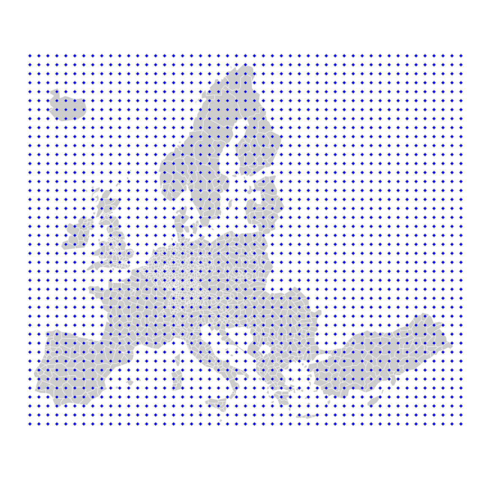
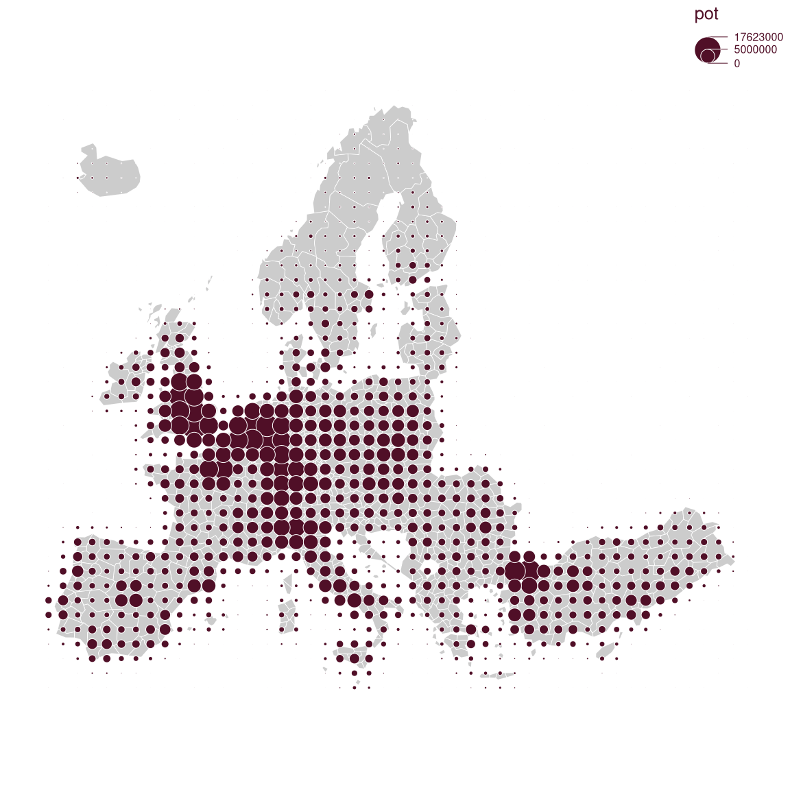
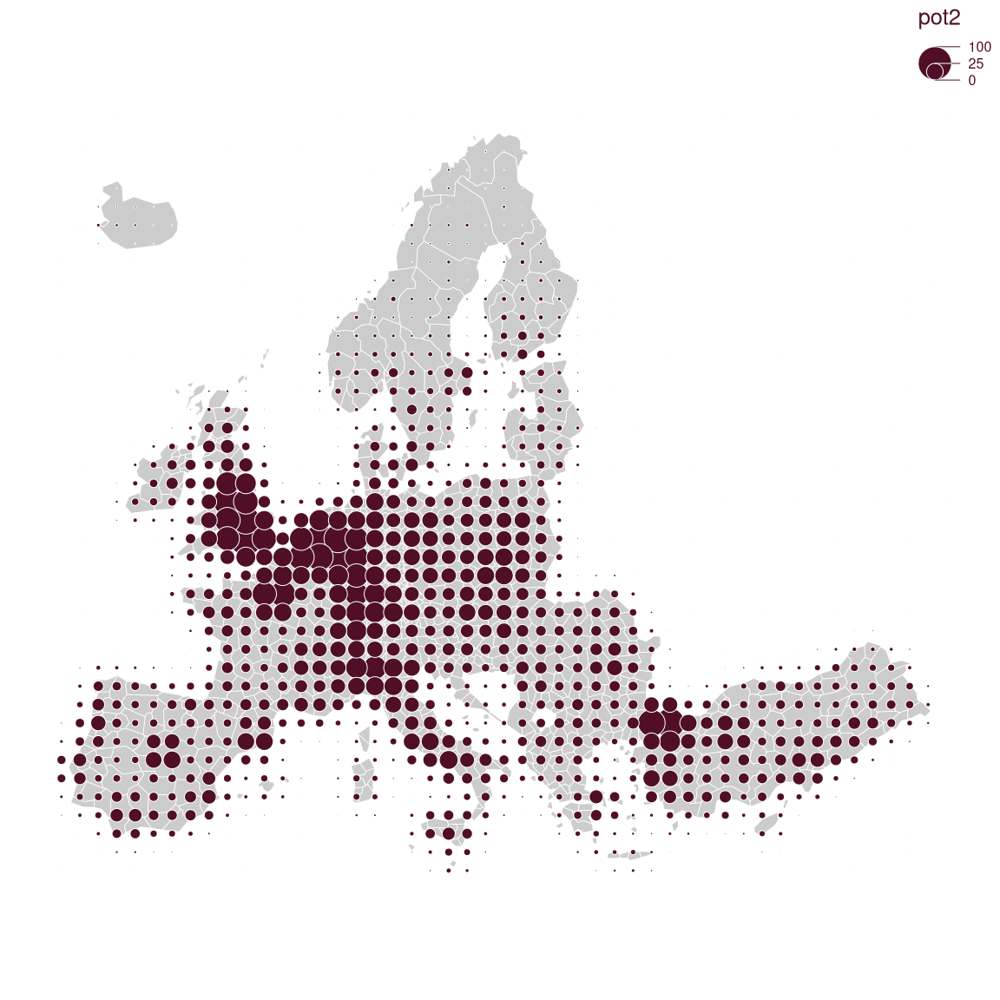
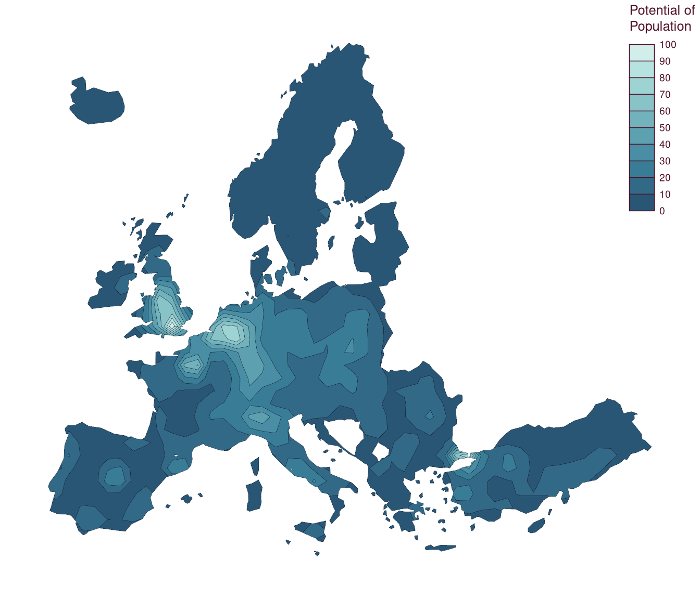
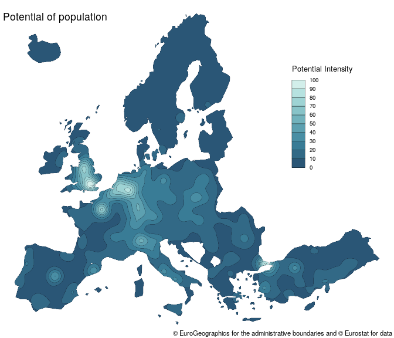

# potential

## Historic and conceptual background

### Modeling spatial interactions

Modeling spatial interactions is used to understand and quantify the
level of interaction between different locations.  
The most ancient and common spatial interactions model the gravity
model. It has roots in the late 19st century and has been used in
several fields (geography, economy, demography) to model a high variety
of flows (commuting, trade, migrations). A brief presentation can be
found in Rodrigue et al. (2013) and a more detailed one, among many
others, in Fotheringham and O’Kelly (1989).

### A place-based model: Stewart’s potentials

There are two main ways of modeling spatial interactions: the first one
focuses on links between places (flows), the second one focuses on
places and their influence at a distance. Following the physics
metaphor, the flow may be seen as the **gravitational force** between
two masses, the place influence as the **gravitational potential**. The
`potential` package, as its name suggests, proposes an implementation of
the place-based model of potential defined by John Q. Stewart (1941).

The Stewart model is also known in the literature, depending on the
discipline, as **potential access**, **gravitational potential** or
**gravitational accessibility**. The concept was developed in the 1940s
by physicist John Q. Stewart from an analogy to the gravity model. In
his seminal work on the catchment areas of American universities,
Stewart computes **potentials of population**. This potential is defined
as a stock of population weighted by distance:

``` math
A_i = \sum_{j=1}^n O_j f(d_{ij})
```

The terms of this equation can be interpreted in a potential approach or
an accessibility approach (in brackets):

- $`A_i`$ is the potential at $`i`$ (the accessibility)
- $`O_j`$ is the stock of population at $`j`$ (the number of
  opportunities)
- $`f(d_{ij})`$ is a negative function of the distance between $`i`$ and
  $`j`$, mainly of the power or the exponential form.

The computation of potentials could be considered as a **spatial
interpolation method** such as inverse distance weighted interpolation
(IDW) or kernel density estimator (KDE). These models aim to estimate
unknown values of non-observed points from known values given by measure
points. Cartographically speaking, they are often used to get a
continuous surface from a set of discrete points. However, we argue that
the Stewart model is mainly a spatial interaction modeling approach,
with a possible secondary use for spatial interpolation.

### The distance friction

Modeling spatial interactions implies quantifying the distance friction
or impedance. The role of the distance can be interpreted as a
disincentive to access desired destinations or opportunities (e.g. jobs,
shops). At the very place of the opportunity, the interaction function
equals 1, meaning that the potential access is 100%. Far away from the
opportunity, the interaction function tends to 0, meaning that the
potential access is 0 %. The **span** is defined as the value where the
interaction function falls to 0.5 (50%). From the individuals’ point of
view, this function may be seen as a degree of availability of a given
opportunity. From the opportunity’s point of view (a store for example),
the interaction function may be seen as a decreasing catchment area:
there is a maximal attraction close to the opportunity and this
attraction decreases progressively through distance.

## Examples

### Potential in one point

The first example details the steps involved in the computation of the
potential for one point ($`A_{i=1}`$). This example is based on a
population dataset of administrative units of the French region of
Occitanie. The stocks of population ($`O_j`$) are located on the
centroids of the regions.



$`O_j`$ and $`_i`$

The first step is computing the distances between the point and all
population places.


$`d_{ij}`$

For the next step we have to select a distance friction function.
[`plot_inter()`](https://riatelab.github.io/potential/reference/plot_inter.md)
allows to visualize the decrease of the interaction intensity with the
distance according to the selected function and its parameters.



$`f(d_{ij})`$

Here, the probability of interaction at the span value (75 km) is 0.5.

We can now use the values of the interaction intensity for each distance
between $`i`$ and $`j`$.



$`f(d_{ij})`$

The contribution of each $`j`$ to the total potential ($`A_i`$) is equal
to the interaction intensity multiplied by its mass ($`O_j f(d_{ij}`$).


$`O_j f(d_{ij})`$

It can be rendered cartographically in the following figure.



$`O_j f(d_{ij})`$

Finally, the value of the potential of $`i`$ is the sum of each $`j`$’s
contributions.

### Potentials in a pseudo-continuous space

A common practice is to compute potentials on points of a regular grid
to estimate potentials on a pseudo-continue surface.

We can use the same dataset as an example of use.

#### Create a regular grid

[`create_grid()`](https://riatelab.github.io/potential/reference/create_grid.md)
is used to create a regular grid with the extent of an existing layer
(`x`) and a specific resolution (`res`). The resolution is set in units
of `x` (here, meters).

``` r

library(potential)
library(mapsf)
mf_map(n3_poly, col= "grey80", border = "white", lwd = .4)
y <- create_grid(x = n3_poly, res = 100000)
mf_map(y, pch = 23, add = TRUE, col = "blue", cex = .5 )
```



#### Create a distance matrix

[`create_matrix()`](https://riatelab.github.io/potential/reference/create_matrix.md)
is used to compute distances between objects.

``` r

d <- create_matrix(x = n3_pt, y = y)
d[1:5, 1:5]
#>         1       2       3       4       5
#> 1 2674796 2578559 2482621 2387015 2291785
#> 2 2622868 2526551 2430532 2334847 2239539
#> 3 2682813 2587272 2492081 2397282 2302922
#> 4 2643075 2547108 2451462 2356179 2261302
#> 5 2638427 2542933 2447799 2353068 2258792
```

The distance is expressed in map units (meters).

#### Compute the potentials

The
[`potential()`](https://riatelab.github.io/potential/reference/potential.md)
function computes potentials.

``` r

y$pot <- potential(x = n3_pt, y = y, d = d,
                   var = "POP19", fun = "e",
                   span = 75000, beta = 2)
mf_map(n3_poly, col= "grey80", border = "white", lwd = .4)
mf_map(y, var = "pot", type = "prop", 
       inches= .1, 
       lwd = .5, 
       leg_val_cex = .5, 
       leg_val_rnd = -3,
       leg_pos = "topright")
```



It’s possible to express the potential relatively to its maximum in
order to display more understandable values (Rich 1980).

``` r

y$pot2 <- 100 * y$pot / max(y$pot)
mf_map(n3_poly, col= "grey80", border = "white", lwd = .4)
mf_map(y, var = "pot2", type = "prop", 
       inches= .1, 
       lwd = .5, 
       leg_val_cex = .5, 
       leg_val_rnd = 0,
       leg_pos = "topright")
```



It’s also possible to compute areas of equipotential with
[`equipotential()`](https://riatelab.github.io/potential/reference/equipotential.md).

``` r

bks <- seq(0, 100, 10)
iso <- equipotential(x = y, var = "pot2", breaks = bks, mask = n3_poly)
mf_map(x = iso, var = "min", type = "choro", 
       breaks = bks, 
       pal = hcl.colors(10, 'Teal'),
       lwd = .2,
       border = "#121725", 
       leg_pos = "topright",
       leg_val_rnd = 0,
       leg_title = "Potential of\nPopulation")
```



#### Compute the potentials using parallel computation

In order to obtain smoother equipotential areas we need to compute the
potentials on a much finer grid and that can be really time consuming
with
[`potential()`](https://riatelab.github.io/potential/reference/potential.md).  
[`mcpotential()`](https://riatelab.github.io/potential/reference/mcpotential.md)
computes potentials with a cutoff distance and parallel computation. The
cutoff distance means that points that are too far away are not taken
into account in the computation. The limits of this function are the
impossibility to provide custom distance matrices (`d`), and the fact
that it only uses Cartesian distances (hence its use for global data is
likely to be inappropriate).

``` r

y <- create_grid(x = n3_poly, res = 20000)
y$pot <- mcpotential(x = n3_pt, y = y, 
                     var = "POP19", fun = "e",
                     span = 75000, beta = 2, 
                     limit = 200000, ncl = 2)
y$pot2 <- 100 * y$pot / max(y$pot)
bks <- seq(0, 100, 10)
iso <- equipotential(x = y, var = "pot2", breaks = bks, mask = n3_poly)
mf_map(x = iso, var = "min", type = "choro", 
       breaks =  seq(0,100, 10), 
       pal = hcl.colors(10, 'Teal'),
       lwd = .2,
       border = "#121725", 
       leg_pos = c(6084270,4253383),
       leg_val_rnd = 0,
       leg_title = "Potential Intensity")
mf_credits(txt = "© EuroGeographics for the administrative boundaries and © Eurostat for data",
           pos = "bottomright", cex = .7)
mf_title(txt = "Potential of population", inner = TRUE, cex = 1.1, pos = "left")
```



## References

Fotheringham, A Stewart, and Morton E O’Kelly. 1989. *Spatial
Interaction Models: Formulations and Applications*. Vol. 1. Kluwer
Academic Publishers Dordrecht.

Rich, David C. 1980. “Potential Models in Human Geography.” *CATMOG 26*
38.

Rodrigue, Jean-Paul, Claude Comtois, and Brian Slack. 2013. “Spatial
Interactions and the Gravity Model.” *The Geography of Transport
Systems.*
<https://transportgeography.org/contents/methods/spatial-interactions-gravity-model/>.

Stewart, John Q. 1941. “An Inverse Distance Variation for Certain Social
Influences.” *Science* 93 (2404): 89–90.
<https://doi.org/10.1126/science.93.2404.89>.
